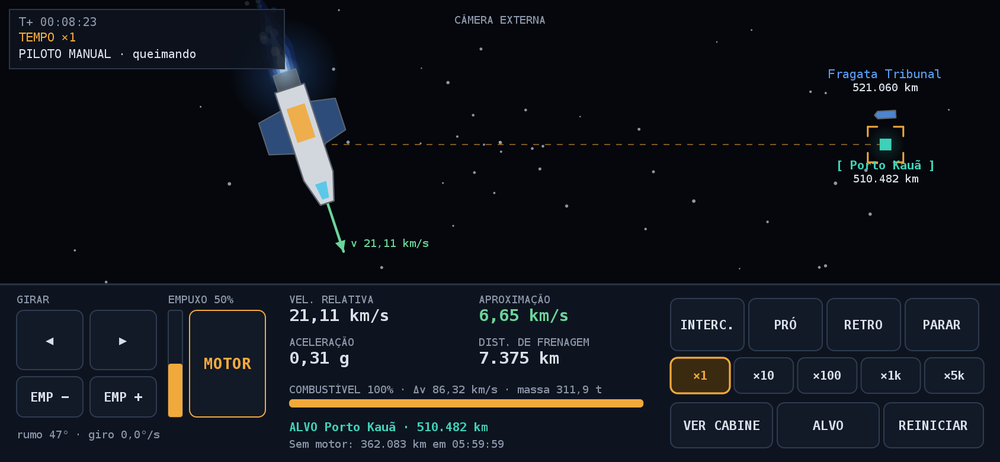
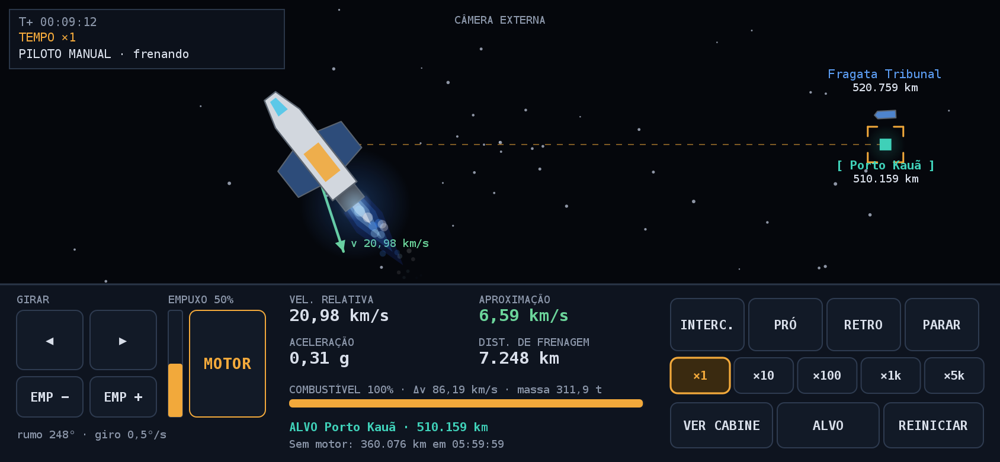
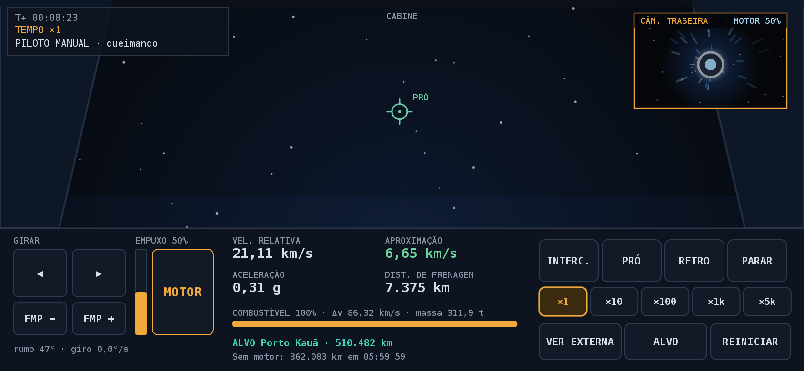
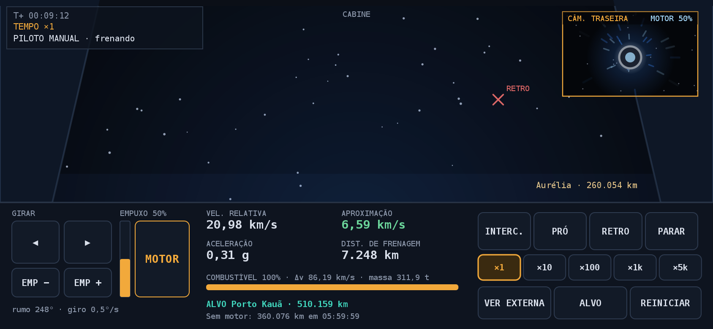

# The Expanse (título provisório)

Jogo de nave com física newtoniana e política espacial, em Kotlin, para Android (só paisagem). Universo e histórias
**originais**, no espírito da ficção científica "hard" de colonização; nada aqui usa personagens, nomes ou enredo de
obras existentes. A primeira campanha é o **Cálice**: levar 40 t de filtros de água ao Porto Kauã, em quarentena.

## O que já existe

- **Física** (`core`, Kotlin puro, sem Android): gravidade do planeta, inércia, empuxo só na direção do nariz
  (para frear é preciso girar e queimar), combustível pela equação do foguete, giro com controle de atitude,
  corpos em órbita analítica, previsão balística, tempo acelerado de ×1 a ×5000 com limite automático de segurança,
  atracação e colisão com o planeta.
- **Piloto automático**: interceptar, alinhar ao prógrado, ao retrógrado e parar o giro.
- **Duas vistas que alternam**: **cabine** e **câmera externa**.
  - Ao queimar, a nave solta um jato de energia azul em movimento (camadas, cintilação e partículas). Na cabine isso
    vira luz azul, vibração e a energia saindo do bocal na câmera traseira.
  - Ao frear, a nave vira de verdade: o giro é simulado, os propulsores de manobra piscam e as estrelas viram riscos.
- **Interface horizontal em âmbar**, com botões de toque (girar e motor são de segurar, multitoque).

### Telas (geradas pelo próprio código, `docs/preview`)

| Aceleração | Frenagem (de costas) |
|---|---|
|  |  |
|  |  |

A virada de 180°, quadro a quadro: [externa](docs/preview/sequencia_virada_externa.png) ·
[cabine](docs/preview/sequencia_virada_cabine.png).

## Estrutura

```
core/     física, simulação e a lista de desenho (Kotlin/JVM puro, testado)
  core/     Vec2, Config, Bodies (Calice), Ship, Autopilot, Simulation
  render/   Prim (primitivas), Fx (jato, propulsores), CockpitView, ExternalView, Hud, GameController
preview/  rasteriza a lista de desenho em PNG com Java2D (./gradlew :preview:run → docs/preview)
app/      app Android: Compose Canvas desenha a lista e repassa os toques (só entra no build com Android SDK)
```

Toda a cena é uma lista de primitivas num espaço fixo de 844×390, montada no `core`. O Android e o preview só a
desenham; assim a interface é testável e verificável sem aparelho.

## Como rodar

```
./gradlew :core:test        # física: órbita, combustível, piloto automático, virar e frear
./gradlew :preview:run      # gera os PNGs em docs/preview
./gradlew :app:assembleDebug   # APK (precisa de Android SDK: ANDROID_HOME ou local.properties)
```

## Validação

O piloto automático para o Porto Kauã reproduz os números do protótipo web (passo de 0,14 s):

| Empuxo | Atraca em | Meta (±5%) |
|---|---|---|
| 50% | 27.152 s | ~27.100 s |
| 100% | 21.248 s | ~21.200 s |
| 20% | 41.493 s | ~41.500 s |

Distância mínima ao centro de Aurélia a 50%: 265.086 km (meta ~265.000 km). Velocidade relativa final < 20 m/s e
nenhuma colisão com o planeta.

**O módulo `app` ainda não foi compilado nem executado em aparelho**: o ambiente de desenvolvimento não tinha
Android SDK. Tudo o que ele faz é desenhar a lista de primitivas e repassar toques, mas precisa de um teste real.

## Próximos passos

1. Testar o APK num aparelho (FPS, toque, tela cheia).
2. Rádio da fragata, reputação das 3 facções, notícias e finais (política).
3. Mapa tático e plano de rota (aceleração de 0,3 g, 1 g ou 2 g).
4. **Pacotes de conteúdo em JSON**, importáveis no app sem recompilar: universo, personagens, missões, mistério
   (pistas, deduções, soluções) e diálogos, com validador e exportação de template para gerar histórias novas.
5. Sistema Solar real (elementos orbitais) e a vista 3D.
