# The Expanse (título provisório)

Jogo de nave com **física newtoniana** e **política espacial** para Android (Kotlin, só paisagem). O universo e as
histórias são **originais**, no espírito da ficção científica "hard" de colonização, sem personagens, nomes ou enredo
de obras existentes. Tudo o que é história vive em **pacotes JSON importáveis**: dá para criar campanhas novas (com
ajuda de uma IA) e jogá-las no aparelho sem recompilar.

## O que o jogo tem

- **Papel fixo por campanha**, definido no JSON e que não muda durante o jogo: **mercador** independente (cargueiro,
  sem armas, com despistadores de mísseis) ou **militar** (comanda o cruzador de uma facção, com mísseis).
- **Cruzadores estelares** com desenho próprio por facção (terrano, marciano, cinturão), lançadores de mísseis e
  três motores com jato azul. Veja a [galeria](docs/preview/21_galeria_naves.png).
- **Combate com mísseis guiados** (navegação proporcional): naves hostis disparam em você; o mercador lança
  **despistadores com chance aleatória** de desviar cada míssil (sorteio por míssil, `chanceDespistar`); o militar
  dispara nos hostis e é impedido de atirar em aliados. Casco, munição, explosões e o tempo cai para ×1 enquanto
  há míssil no ar. Veja a [sequência do míssil](docs/preview/sequencia_missil_externa.png).
- **Cena de atracação e de saída**: aproximação final, alinhamento com propulsores de manobra, travas e a estação
  girando ([sequência](docs/preview/sequencia_atracacao.png)). Toque para pular.
- **Chegada no painel**: tempo de jogo até chegar e o **tempo real** na escala escolhida, com contagem regressiva.
  O nível de cruzeiro (`escalaTempo`, padrão 1440 = um dia de jogo por minuto real) faz uma viagem de 5 dias durar
  5 minutos. O tempo estimado é calculado em segundo plano com o próprio piloto automático.
- **Câmera giratória** na cabine, na externa e na **vista 3D**: botões de segurar, arrastar o dedo e pinça para zoom.
- **Vista 3D**: câmera em perspectiva que gira e inclina em volta da nave, com chão de grade no plano orbital,
  planetas como esferas, estações como anéis, cruzadores em perspectiva, mísseis e explosões. A simulação é plana
  (as inclinações reais dos planetas, de poucos graus, são ignoradas); a 3D é a forma de olhar para ela.
- **Sistema Solar real**: órbitas keplerianas elípticas em hierarquia (luas em torno de planetas, estações em torno
  de luas), gravidade de vários corpos e colisão com planetas. A campanha **Rota do Gelo** voa de Ceres a Marte
  (239 milhões de km) em ~5,7 dias de jogo com o piloto automático, ~5 minutos reais em escala de cruzeiro.
- **Escolta e abordagem** no motor: `ia` com `escoltar` faz uma nave acompanhar você, interceptar mísseis e atirar em
  hostis; `abordar` faz uma nave chegar e abordá-lo; o militar aborda de perto e devagar (chance = 1 − `defesa`).
- **Vocabulário ampliado**: gatilhos `abordado`, `abordagem`, `casco_abaixo`, `combustivel_abaixo`, `a_cada`,
  `reputacao_na_faixa`, `objeto_obtido`, `deducao_feita`, `missao_mudou`, `escolta_interceptou`, `missil_lancado`;
  condições `contador`, `casco`, `combustivel`, `atracado`, `corpo_vivo`, `distancia`, `tempo_maior`, `aleatorio`, `alvo`;
  efeitos `contador`, `se`, `executar`, `agendar`, `emboscar`, `revelar_corpo`, `ocultar_corpo`, `destruir_corpo`,
  `casco`, `combustivel`, `municao`; e **blocos** nomeados de efeitos (que sobrevivem ao salvamento).
- **Vários salvamentos por campanha**, com nome editável (caixa de texto do Android), automático separado, apagar com
  confirmação e leitura dos salvamentos antigos.

- **Física real**: gravidade do planeta, inércia, empuxo só na direção do nariz (para frear é preciso girar e queimar),
  combustível pela equação do foguete, corpos em órbita analítica, previsão balística, tempo de ×1 a ×5000 com limite
  automático de segurança, atracação e colisão.
- **Piloto automático**: interceptar, alinhar ao prógrado/retrógrado, parar o giro. Alerta "INVERTER AGORA".
- **Cabine e câmera externa**, que alternam. Ao queimar, a nave solta um jato de energia azul em movimento; na cabine
  isso vira luz azul, vibração e o jato na câmera traseira. Ao frear, a nave vira de verdade (propulsores de manobra,
  estrelas em risco).
- **Mapa tático**, **plano de rota** (tempo e combustível reais de 3 níveis de empuxo, simulados com o próprio piloto
  automático), **estações** com pessoas para conversar, **diálogos com escolhas**, **caderno de investigação**
  (pistas → deduções → acusação), **porão** (objetos têm massa e pesam na física), **reputação** de facções,
  **notícias**, **finais** e **salvamento automático**.
- **Perseguição**: a fragata do Cálice passa a ser integrada (3 m/s², para a 20 km) quando você corta o rádio.
- **Campanhas** incluídas: **Cálice** (mercador; política e rádio, 8 finais), **O silêncio do Albatroz** (mercador;
  mistério de investigação, 6 pistas, 3 suspeitos, 4 finais), **Emboscada sobre Aurélia** (mercador atacado por
  fragata com mísseis), **Patrulha do Tribunal** (militar: cruzador da Coalizão contra um corsário) e **Rota do Gelo**
  (Sistema Solar real: escolta, corsários, abordagem, pedágio).

### Telas (geradas pelo próprio código em `docs/preview`)

| Início | Importação recusada |
|---|---|
| 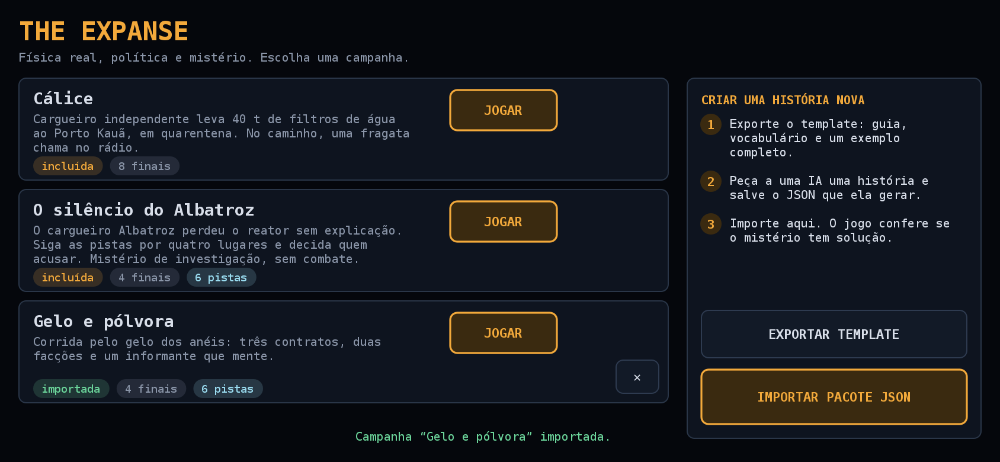 | 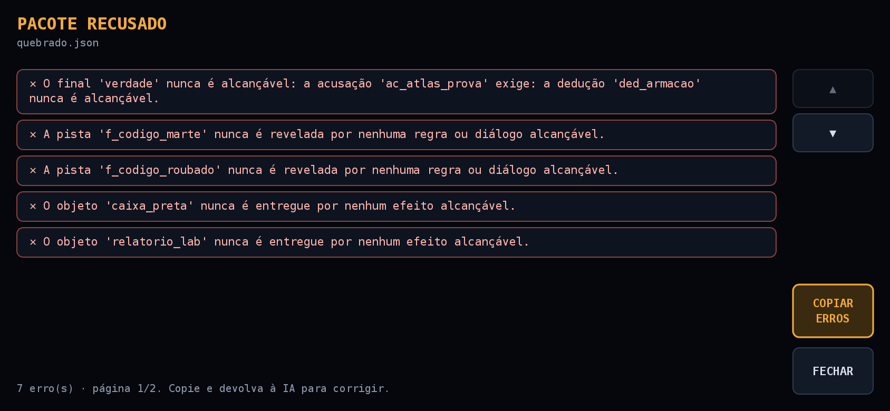 |

| Acelerando (cabine) | Frenando de costas (externa) |
|---|---|
| 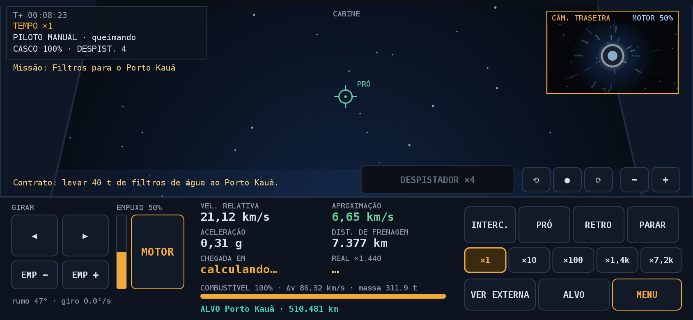 | 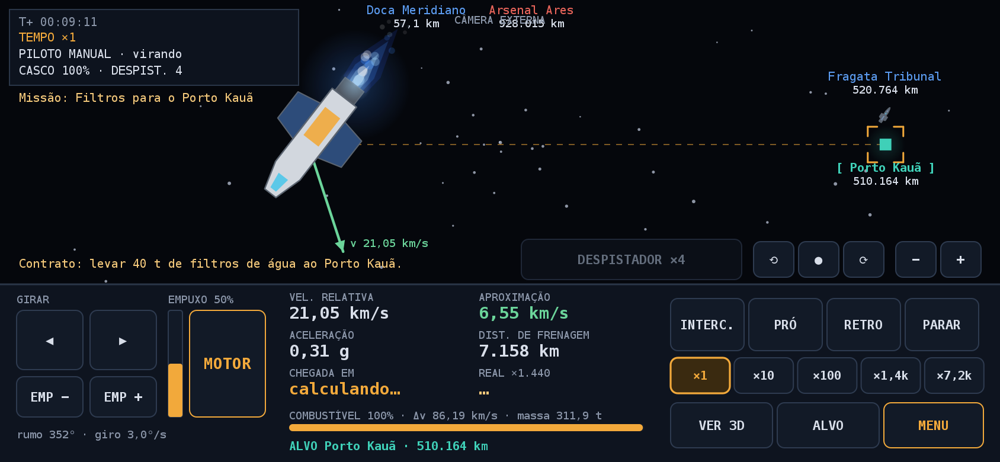 |

| Mapa tático | Plano de rota |
|---|---|
| 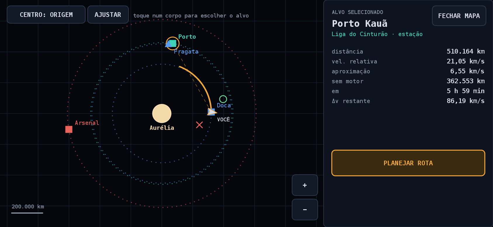 | 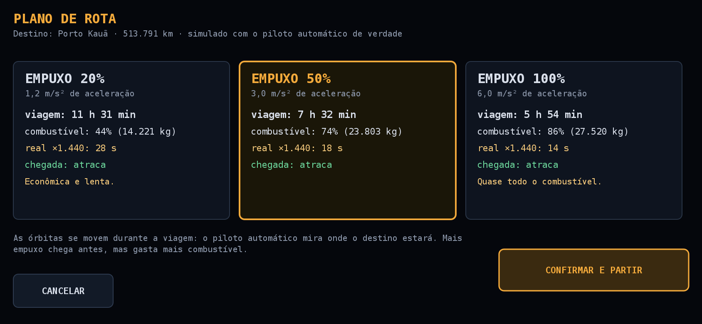 |

| Míssil em voo | Despistador lançado |
|---|---|
| 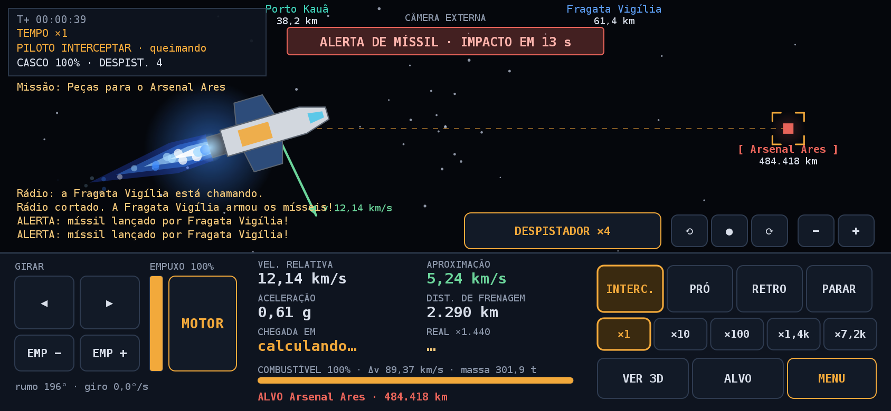 | 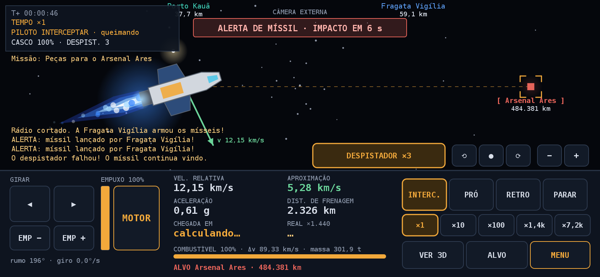 |

| Impacto (cabine) | Cruzador da Coalizão atira |
|---|---|
| 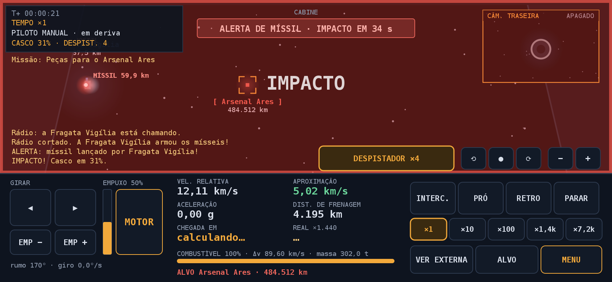 | 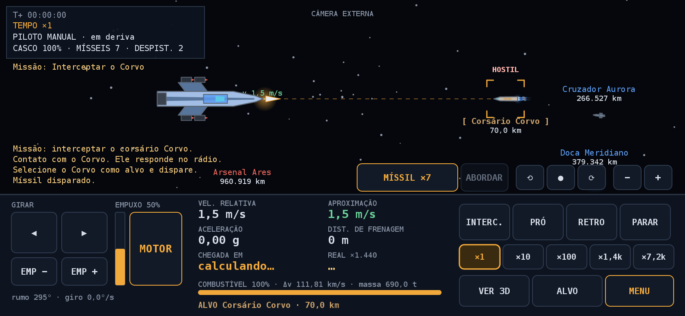 |

| Painel: chegada em tempo de jogo e real | Câmera girada (cabine) |
|---|---|
| 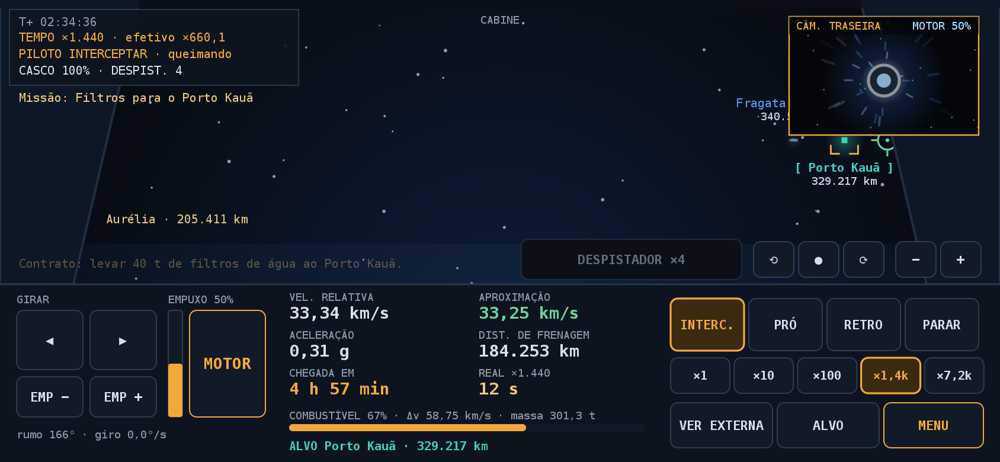 | 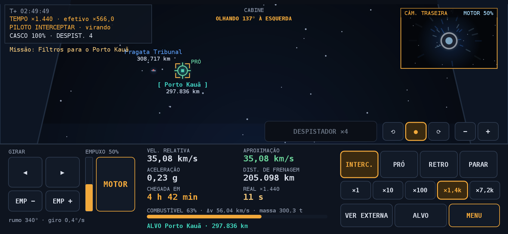 |

| Sistema Solar: mapa | Vista 3D com escolta |
|---|---|
| 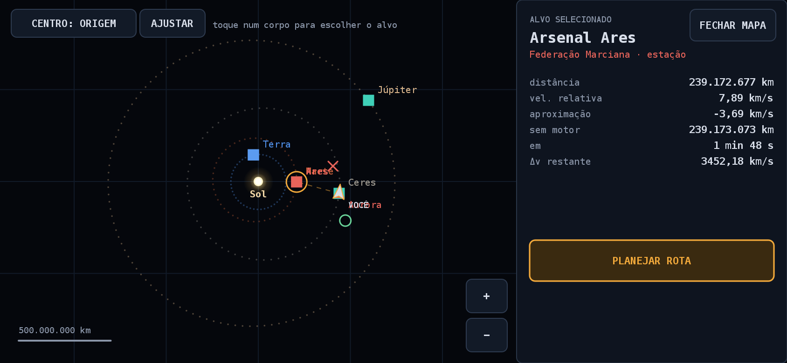 | 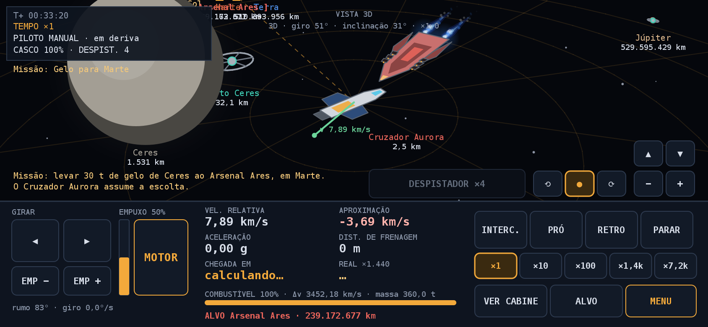 |

| Rota até Marte em escala de cruzeiro | Salvamentos |
|---|---|
| 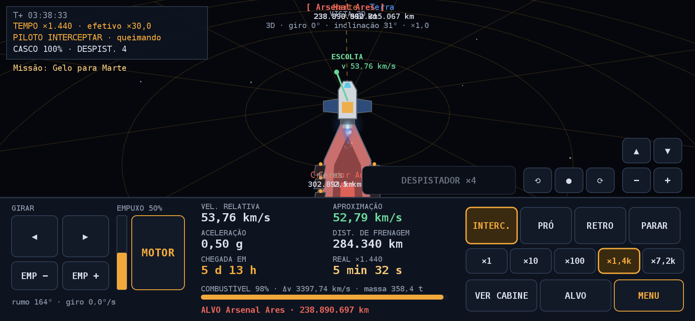 | 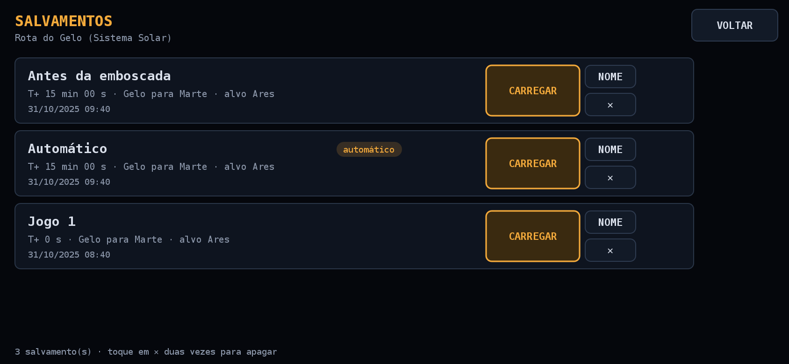 |

| Abordagem do cruzador | Menu |
|---|---|
| 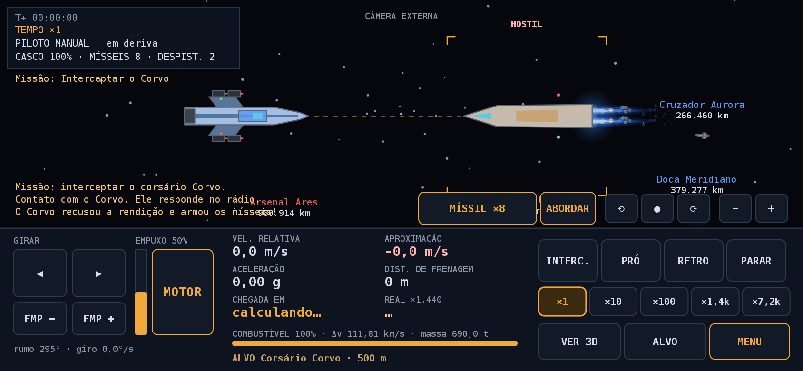 | 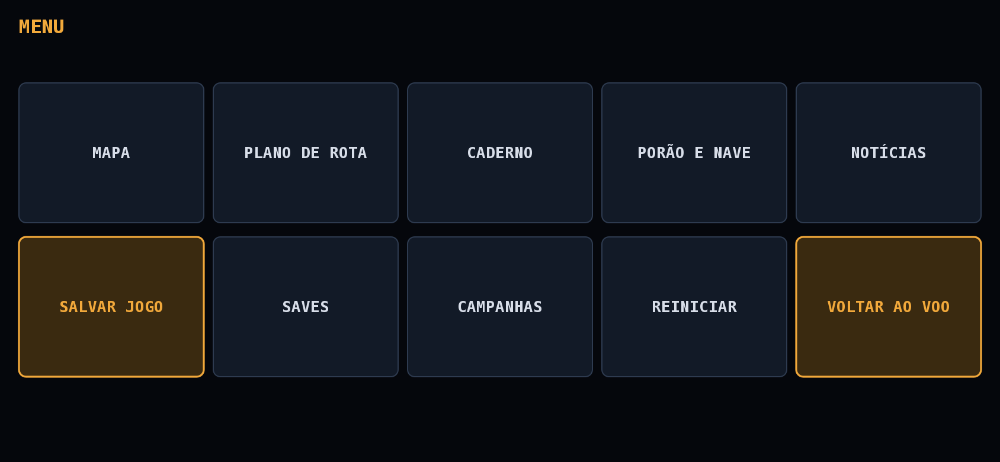 |

| Rádio da fragata | Caderno |
|---|---|
| 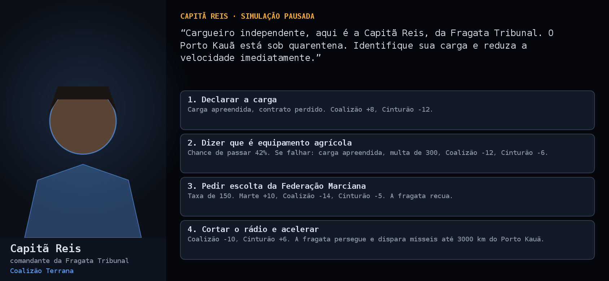 | 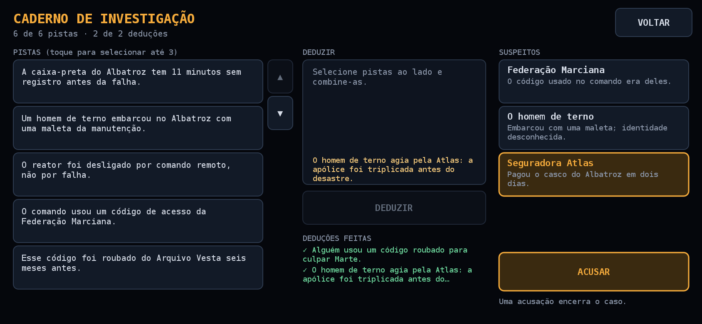 |

Mais: [virada de 180° na cabine](docs/preview/sequencia_virada_cabine.png) ·
[virada na externa](docs/preview/sequencia_virada_externa.png) · [estação](docs/preview/12_estacao_destrocos.png) ·
[diálogo](docs/preview/13_dialogo_ilse.png) · [porão](docs/preview/16_porao.png) ·
[notícias](docs/preview/17_noticias.png) · [final](docs/preview/20_final_albatroz.png).

## Criar uma campanha nova

1. No app, em **Campanhas → Exportar template**: sai um arquivo com o guia, o vocabulário completo (gatilhos,
   condições e efeitos) e um exemplo válido. A cópia atual está em [`docs/the_expanse_template.md`](docs/the_expanse_template.md).
2. Entregue o arquivo a uma IA e peça "crie uma campanha nova seguindo este guia: [sua ideia]". Salve o JSON.
3. **Importar pacote JSON** (ou "Abrir com…" no Android). O jogo decodifica, valida e só então instala.

JSON é **dado, não código**: o pacote combina o que o motor sabe fazer (órbitas, naves, facções, diálogos, regras,
pistas, deduções, finais), mas não inventa mecânica nova. Nada executa no aparelho, e nenhuma IA é usada durante o jogo.

### O validador

Erros citam o caminho do trecho, em português, para devolver à IA:

```
regras[1].entao[0]: efeito 'dar_objto' desconhecido (válidos: mensagem, reputacao, ..., dar_objeto, ...)
O final 'verdade' nunca é alcançável: a acusação 'ac_atlas_prova' exige: a dedução 'ded_armacao' nunca é alcançável.
corpo 'lab': órbita de 50000000 m fica dentro ou colada no planeta (raio 60000000 m).
nave: Δv de 1500 m/s é pequeno demais para viagens entre estações (mínimo 2000 m/s; ...).
```

Ele confere referências, órbitas, **física** (o piloto automático consegue chegar às estações citadas?) e a
**alcançabilidade do mistério**: simula as regras de forma abstrata e acusa pistas que ninguém revela, objetos que
ninguém entrega, deduções impossíveis e finais inalcançáveis (exige ao menos um final de vitória).

## Estrutura

```
core/     Kotlin/JVM puro (sem Android), testado
  core/     Vec2, Config, World/Body, Ship, Autopilot, Simulation (inclui corpos dinâmicos e salvamento)
  content/  Model, Vocabulary (fonte única do guia e da validação), Decoder, Validator, Template, Builtin
  game/     GameSession (motor de história: gatilhos, efeitos, diálogos, deduções), RoutePlanner, Storage/Host
  render/   lista de desenho (Prim), Fx, CockpitView, ExternalView, Hud, Screens, AppController
  resources/packs/  calice.json, albatroz.json
preview/  rasteriza a lista de desenho em PNG (Java2D) — gera docs/preview
app/      Android: Compose Canvas desenha a lista; seletor de arquivos, compartilhar, área de transferência
```

Toda a interface é uma lista de primitivas num espaço fixo de 844×390, montada no `core`; o Android e o preview só a
desenham. Por isso as telas e os fluxos de toque são testados sem aparelho.

## Como rodar

```
./gradlew :core:test            # física, combate, Sistema Solar, pacotes, validador, história, salvamentos, telas e fluxos de toque
./gradlew :preview:run          # gera os PNGs em docs/preview e o template
./gradlew :app:assembleDebug    # APK (precisa de Android SDK: ANDROID_HOME ou local.properties com sdk.dir)
```

## Validação

O piloto automático reproduz os números do protótipo web (passo de 0,14 s): atraca no Porto Kauã em 27.152 s (50%),
21.248 s (100%) e 41.493 s (20%); o rádio chama em 18.910 s; a distância mínima ao centro de Aurélia é de 265.086 km.
Há testes de partida completa das duas campanhas (inclusive todos os finais do Cálice e a solução do mistério pelo
piloto automático), salvamento e carga, importação de pacotes válidos e quebrados e reinício com estado inicial exato.

## O que não foi verificado

- **O APK compila (`assembleDebug`), mas nunca foi executado** em aparelho nem em emulador. Toque, multitoque,
  arrastar e pinça da câmera, FPS, tela cheia, seletor de arquivos, "Abrir com…" e área de transferência estão por
  testar de verdade.
- Só estações e destroços são atracáveis. Chegar a um planeta destrói a nave (não há pouso).
- A caixa de texto para renomear salvamentos (`AlertDialog`) e os gestos de arrastar e pinça só existem no Android e
  não foram executados.
- O equilíbrio do combate (alcance de 80 km, mísseis a 80 m/s², dano de 45 a 80) é um primeiro ajuste, não testado
  com jogadores.
- O carregamento das campanhas incluídas (resources do `core`) foi conferido dentro do APK, mas não em execução.
- Os PNGs vêm do rasterizador Java2D; a fonte e o anti-serrilhado no Android serão um pouco diferentes.

## Papel, tempo e naves no JSON

```json
"papel": {"tipo": "militar", "faccao": "coalizao"},
"escalaTempo": 1440,
"facoes": [{"id": "coalizao", "nome": "...", "cor": "#5B9BF0", "estilo": "terrano"}],
"nave": {"misseis": 8, "despistadores": 2, "chanceDespistar": 0.4, "casco": 220, "...": "..."},
"corpos": [{"id": "corvo", "tipo": "nave", "misseis": 3, "despistadores": 1, "chanceDespistar": 0.4, "...": "..."}]
```

Efeito `ia` com `atacar` libera uma nave hostil a perseguir e disparar; gatilho `corpo_destruido` e condição `papel`
reagem ao combate. O validador confere o papel, a facção do militar e que só naves podem ser destruídas.

## Roteiro de teste

[`docs/TESTE_COMPLETO.md`](docs/TESTE_COMPLETO.md) lista o que conferir no aparelho, campanha por campanha.

## Próximos passos

Física 3D de verdade (hoje a simulação é plana); mais corpos do Sistema Solar (Vênus, Mercúrio, Saturno e suas luas);
mais comportamentos de IA (patrulha por rota, fuga); equilíbrio do combate com jogadores; sons.
